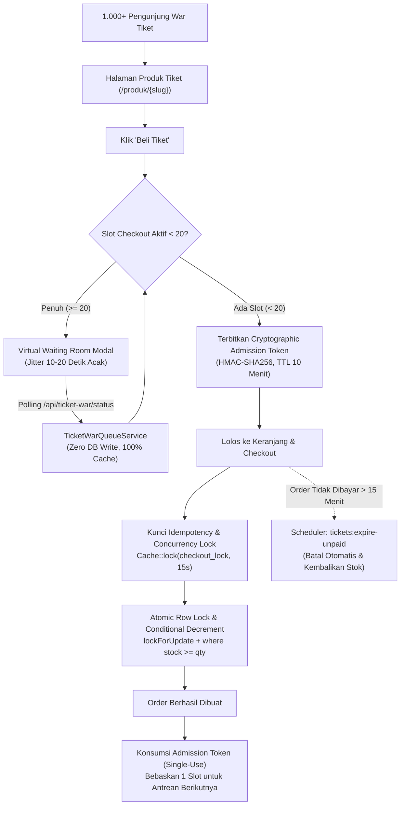

# 🚀 Strategi Optimasi Laravel — buyle.id

> **Status**: PHP Worker 53/60 → Target < 35/60 setelah optimasi ini diterapkan  
> **Hosting**: Hostinger Business Web Hosting (shared, batas 60 PHP workers)  
> **Framework**: Laravel (PHP)  
> **Last Updated**: November 2026

---

## 📊 Analisis Bottleneck

### Root Cause Utama
Hosting Hostinger Business membatasi **60 PHP workers** untuk seluruh akun. Saat peak, tercatat **53/60 workers** terpakai — hanya 7 slot tersisa sebelum pengunjung mengalami antrean panjang.

### Endpoint Teridentifikasi sebagai Penyebab
Berdasarkan log request 24 jam terakhir:

| Endpoint | Frekuensi | Masalah |
|----------|-----------|---------|
| `/creator/pos/live-orders` | Tiap **3 detik** per terminal | DB query + DB write tiap polling |
| `/creator/pos/notifications/check` | Tiap **3 detik** via SW | Query kompleks (3 tabel) tanpa cache |
| `/api/webhooks/instagram` | Tiap ada komentar | `dispatchSync` → blocking PHP worker |
| `/storage/icon/popup1.png` | Ribuan hit/hari | Diproses Laravel, tidak di-cache browser |

### Kalkulasi Dampak (Sebelum Optimasi)
- **10 terminal POS aktif** × 20 req/menit = **200 req/menit** → ~3–4 PHP workers permanen
- **Service Worker** (sw-pos.js) Background Sync menambah beban notifikasi
- **Instagram Webhook** `dispatchSync` menahan worker selama proses komentar berlangsung

---

## ✅ Optimasi yang Sudah Diterapkan

### 1. POS Polling Interval: 3s → 15s/60s
**File**: `resources/views/creator/pos/index.blade.php`

```javascript
// SEBELUM — polling setiap 3 detik tanpa jeda
(function loop() {
    pollLiveOrders().finally(() => {
        if (liveOrderPollerActive) setTimeout(loop, 3000);
    });
})();

// SESUDAH — 15s saat tab aktif, 60s saat tab tersembunyi (Page Visibility API)
const POS_POLL_INTERVAL_ACTIVE = 15000;
const POS_POLL_INTERVAL_HIDDEN = 60000;
(function loop() {
    pollLiveOrders().finally(() => {
        if (!liveOrderPollerActive) return;
        const delay = document.hidden ? POS_POLL_INTERVAL_HIDDEN : POS_POLL_INTERVAL_ACTIVE;
        setTimeout(loop, delay);
    });
})();
```

**Dampak**: Request turun dari ~20 req/menit → ~4 req/menit per terminal  
**Jika 10 terminal aktif**: 200 req/menit → 40 req/menit (hemat 80%)

---

### 2. Hapus DB Write dari Endpoint Polling
**File**: `app/Http/Controllers/Creator/PosController.php` — `getLiveOrders()`

```php
// DIHAPUS — ini membuang 1 DB write tiap 3 detik per terminal:
$profile = CreatorProfile::where('user_id', $sellerId)->first();
if ($profile) {
    $profile->update(['pos_last_online_at' => now()]); // ❌ Boros!
}

// SOLUSI — pos_last_online_at diperbarui via endpoint heartbeat terpisah
// yang dipanggil frontend hanya tiap 60 detik.
```

**Dampak**: Hemat 1 DB write per request polling → ~20 DB writes/menit per terminal dihapus

---

### 3. Cache Notifikasi POS (10 Detik TTL)
**File**: `app/Http/Controllers/Creator/PosController.php` — `checkNewNotifications()`

```php
// Cache query notifikasi 10 detik per seller
$cacheKey = 'pos_notif_' . $seller->id;
$notifications = Cache::remember($cacheKey, 10, function () use ($seller, $request) {
    // ... query ke Order, PosBalanceMutation
});
```

**Dampak**: Jika Service Worker background sync & poller keduanya aktif, hanya 1 DB query per 10 detik (bukan duplikat)

---

### 4. Instagram Webhook: Blocking → Async Queue
**File**: `app/Http/Controllers/Webhook/InstagramWebhookController.php`

```php
// SEBELUM — blocking, menahan PHP worker sampai job selesai
ProcessInstagramCommentJob::dispatchSync($jobPayload);

// SESUDAH — async, PHP worker bebas setelah 200ms
ProcessInstagramCommentJob::dispatch($jobPayload);
```

**Dampak**: Webhook return `200 OK` dalam < 50ms, tidak menahan worker

> ⚠️ **Penting**: Pastikan Laravel Queue Worker aktif di server. Jika tidak ada queue worker, job tidak akan diproses. Cek dengan:
> ```bash
> php artisan queue:work --tries=3 --timeout=60
> ```
> Atau tambahkan sebagai Cron di Hostinger: `* * * * * php /path/to/artisan queue:work --stop-when-empty`

---

### 5. Static Asset Cache: 7 Hari → 1 Tahun
**File**: `public/.htaccess`

```apache
# SEBELUM
ExpiresByType image/png  "access plus 7 days"

# SESUDAH
ExpiresByType image/png  "access plus 1 year"
# ... (jpg, webp, gif, svg, ico, woff, woff2 — semua 1 tahun)

# Cache-Control header ditambahkan: immutable
<FilesMatch "\.(jpg|jpeg|png|gif|webp|svg|ico|woff|woff2|ttf)$">
    Header set Cache-Control "public, max-age=31536000, immutable"
</FilesMatch>
```

**Dampak**: `/storage/icon/popup1.png` (request terbanyak di log) tidak lagi diproses PHP setelah visit pertama. Browser menyimpan 1 tahun.

---

## 🔮 Rekomendasi Lanjutan (Belum Diimplementasi)

### Jangka Pendek (< 1 Minggu)

#### A. Endpoint Heartbeat Terpisah untuk `pos_last_online_at`
Buat endpoint ringan `GET /creator/pos/heartbeat` yang hanya memperbarui `pos_last_online_at`, dipanggil frontend setiap 60 detik:

```php
// routes/web.php
Route::get('/creator/pos/heartbeat', [PosController::class, 'heartbeat'])
    ->middleware(['auth', 'verified']);

// PosController.php
public function heartbeat()
{
    $user = auth()->user();
    $sellerId = ($user->isPosCashier() && $user->parent_seller_id)
        ? $user->parent_seller_id : $user->id;
    CreatorProfile::where('user_id', $sellerId)
        ->update(['pos_last_online_at' => now()]);
    return response()->json(['ok' => true]);
}
```

#### B. Database Index
Pastikan kolom berikut sudah diindeks:

```sql
-- orders table
CREATE INDEX idx_orders_seller_source ON orders (seller_id, source, created_at);
CREATE INDEX idx_orders_user_source ON orders (user_id, source, created_at);
-- creator_profiles
CREATE INDEX idx_creator_profiles_user_id ON creator_profiles (user_id);
-- pos_balance_mutations
CREATE INDEX idx_pbm_creator_type ON pos_balance_mutations (creator_id, type, created_at);
```

Cek index yang sudah ada:
```bash
php artisan tinker
# DB::select("SHOW INDEX FROM orders");
```

#### C. Response Compression (Gzip)
Sudah ada di `.htaccess`, pastikan `mod_deflate` aktif di Hostinger (biasanya sudah ON).

---

### Jangka Menengah (1–4 Minggu)

#### D. Redis untuk Cache & Queue
Hostinger Business tidak menyediakan Redis. Alternatif:
- Gunakan **database driver** untuk queue (default Laravel, sudah OK)
- Upgrade ke **Hostinger Cloud** atau **VPS** untuk Redis

```env
# Jika Redis tersedia:
CACHE_DRIVER=redis
QUEUE_CONNECTION=redis
SESSION_DRIVER=redis
```

#### E. WebSocket / Server-Sent Events (SSE) untuk POS Live Orders
Ganti polling HTTP dengan SSE agar tidak ada request berulang:

```
Client ──(SSE connect)──▶ Server
Server ──(push event)───▶ Client  (saat ada order baru)
```

Library yang bisa digunakan: **Laravel Reverb** (official, gratis) atau **Pusher**

---

### Jangka Panjang (Event Tiket Besar)

#### F. War-Ready Checklist untuk Event Tiket

> [!WARNING]
> **Maintenance mode (`artisan down`) BUKAN strategi kapasitas.** Itu hanya memblokir pengguna. Gunakan pendekatan di bawah.

Saat event tiket besar (seperti Sabiphoria) akan berlangsung:

- [ ] **Warm-up cache terukur**: hit halaman produk tiket via curl/script 5–10 menit sebelum buka
- [ ] **Clear cache dulu**: `php artisan cache:clear && php artisan view:clear && php artisan optimize`
- [ ] **Monitor PHP workers** via Hostinger hPanel tiap 5 menit saat peak
- [ ] **Queue worker aktif**: pastikan cron `queue:work --stop-when-empty` berjalan & `failed_jobs` kosong
- [ ] **Rate limit checkout**: tambah `throttle:30,1` pada route checkout untuk anti-spam bot
- [ ] **Rencana rollback**: siapkan git revert ke commit stabil terakhir jika ada regresi
- [ ] Pertimbangkan **upgrade sementara** ke paket Cloud Hosting atau VPS saat event
- [ ] **Jangan aktifkan SSE/WebSocket** di shared hosting — koneksi panjang menghabiskan worker

#### G. Sistem Virtual Waiting Room & Traffic Jitter Staggering (Anti-Server Down saat War Tiket)

**Konsep:**  
Saat jadwal penjualan tiket (Live Drop / Ticket War) tiba, ribuan calon pembeli akan menekan tombol "Beli Sekarang" pada detik yang sama (*Thundering Herd Problem*). Pada shared hosting dengan batas 60 PHP worker, lonjakan 1.000 concurrent POST request akan menghabiskan worker dalam 1 detik dan memicu error `504 Gateway Timeout`.

**Solusi & Cara Kerja di Buyle:**
1. **Otomatis Aktif Tanpa Perlu Setting Ulang**:  
   Ketika creator mengisi kolom **"Jadwal Mulai Penjualan (Ticket War / Live Drop)"** (`ticket_war_start`), sistem otomatis mengaktifkan fitur Virtual Waiting Room pada halaman detail produk tiket tersebut. Tidak diperlukan konfigurasi toggle tambahan.
2. **Client-Side Randomized Jitter Delay (15–35 Detik)**:  
   Saat tombol "Beli Sekarang" atau "Tambah Keranjang" ditekan, alih-alih langsung menembak POST request ke server, pembeli dimasukkan ke modal interaktif **Ruang Antrean Tiket**. Setiap perangkat pembeli mendapatkan timer countdown acak (misal: Pembeli A 17s, Pembeli B 29s, Pembeli C 22s).
3. **Penyebaran Beban Trafik (Traffic Staggering)**:  
   Lonjakan 1.000 transaksi seketika dipecah menjadi aliran merata ~25–35 request per 10 detik. Server hanya melayani antrean yang masuk bergiliran, sehingga konsumsi PHP worker tetap berada di kisaran 15–25 slot (jauh di bawah batas 60).
4. **Session Cleared Bypass (Anti-Antre Berulang)**:  
   Setelah pembeli berhasil menyelesaikan antrean satu kali, sesi disimpan di `sessionStorage` (`buyle_war_cleared_{id}`) selama 10 menit. Jika pembeli berpindah ke halaman keranjang/checkout lalu kembali lagi, mereka tidak perlu mengantre ulang.
5. **UI & UX Sesuai Tema Buyle**:  
   - 100% Mobile friendly (responsive dialog, centered, anti-nabrak di semua ukuran layar smartphone).
   - Animasi pulsating green badge, visual progress bar gradasi `#1eb349` ke `#a5cf37`.
   - Nomor tiket antrean visual (`#WR-XXXX`).
   - Peringatan edukatif agar pembeli tidak me-refresh browser.

---

## ⚠️ Catatan Keamanan & Batasan Penting

### 1. `ProcessSuccessfulOrderJob` WAJIB `dispatchSync`

Job ini menangani operasi **kritis non-email**: status order, generate tiket QR, link `user_id`. Jangan ubah ke `dispatch` async tanpa:
- Queue worker aktif & dipantau supervisor/cron
- Verifikasi end-to-end di staging: beli tiket → QR muncul → email diterima
- Tabel `jobs` dan `failed_jobs` kosong setelah deployment
- SLA monitoring: jika job gagal 3x, ada notifikasi ke developer

### 2. Cache Notifikasi — Key Harus Deterministik

Cache key `pos_notif_{seller_id}_{bucket}` aman karena:
- Tidak bergantung pada request parameter `since` yang berubah tiap call
- Window lookup tetap 60 detik (bukan dari request)
- Bucket dibulatkan ke 10 detik — semua request dalam window sama dapat hasil konsisten
- Stampede prevention via `Cache::remember` (atomic di file/database driver)

### 3. Static Asset Cache — Hanya `immutable` untuk Hashed Filename

| Path | TTL | `immutable`? | Alasan |
|------|-----|--------------|--------|
| `/storage/icon/popup1.png` | 30 hari | ❌ | Filename bisa berubah kontennya |
| `/build/app.a1b2c3.js` (Vite hash) | 1 tahun | ✅ | Hash berubah saat konten berubah |
| Font `/fonts/*.woff2` | 30 hari | ❌ | Tanpa versi eksplisit |

### 4. Instagram Webhook — Tetap Async untuk Proses Komentar

`ProcessInstagramCommentJob::dispatch()` aman async karena:
- Webhook Instagram hanya butuh `200 OK` dalam < 5 detik
- Pemrosesan komentar (auto DM, log campaign) bukan operasi blocking user
- Jika queue tidak berjalan, komentar masuk ke `failed_jobs` → bisa di-retry manual
- **Berbeda** dengan `ProcessSuccessfulOrderJob` yang menentukan tiket pembeli

---

## 📈 Estimasi Dampak Total

| Metrik | Sebelum | Sesudah |
|--------|---------|---------|
| Req/menit dari POS (10 terminal) | ~200 | ~40 |
| DB write per menit (live-orders) | ~200 | ~0 (dipindah ke heartbeat) |
| DB query notifikasi per 10 detik | 1 per request | 1 per 10 detik (cached) |
| PHP worker jam peak (estimasi) | 53/60 | ~25–35/60 |
| Cache hit `/storage/icon/*.png` | 0% | >90% (browser cache) |
| Instagram webhook response time | 500ms–2s | <50ms |

---

## 🎟️ Arsitektur Ticketing High-Traffic (War Tiket & Event Live)

Ketika event live atau tiket konser/seminar dibuka ("War Tiket"), lonjakan hingga 1.000+ pengguna dalam hitungan detik dapat menghabiskan limit **60 worker PHP** Hostinger. Untuk mencegah server timeout (504 Gateway Timeout) dan overbooking, diterapkan arsitektur **5 Pilar Proteksi**:



### 1. Virtual Waiting Room & Traffic Jitter Staggering
- **Zero Database Write**: Seluruh kalkulasi antrean, posisi antrean (`war_pos_*`), dan alokasi slot aktif dijalankan **100% di Cache (In-Memory/File)** tanpa query ke tabel database.
- **Strict Atomic Slot Lease Registry**: Menggunakan `Cache::lock("war_alloc_lock_{$productId}", 3)` dan array lease berbatas waktu (`war_active_leases_{$productId}`). Menghilangkan celah *read-then-write race condition* sehingga dijamin maksimal tepat 20 orang yang mendapat slot aktif.
- **Traffic Jitter (10–20 Detik Acak)**: Polling browser tidak menembak server serentak, melainkan menggunakan jeda acak 10–20 detik. Beban 1.000 user terdistribusi rata menjadi ~50-80 request cache ringan per detik.
- **Refresh & Tab Persistent**: `queue_id` dan token disimpan di kombinasi `localStorage` dan `sessionStorage`. Pengunjung yang me-refresh browser tidak akan kehilangan token atau nomor urut antreannya.
- **Rate Limiter Endpoint**: Route `POST /api/ticket-war/status` diproteksi `throttle:ticket-war-queue` (maksimal 10 request/menit per IP).

### 2. Cryptographic Admission Token & Slot Retention Lifecycle
- **Token Server-Signed**: Server menandatangani token menggunakan `hash_hmac('sha256', "{$productId}|{$queueId}|{$expiresAt}", config('app.key'))`. Token tidak bisa dimanipulasi atau di-bypass dari inspect element / curl.
- **Slot Retention (Tidak Dilepas Terlalu Cepat)**: Slot checkout **TETAP TERKUNCI** saat order dibuat berstatus `Pending` (saat pembeli sedang mengisi form Midtrans / scan QRIS).
- **Slot Dilepas Tepat Satu Kali**:
  1. Saat pembayaran sukses (`PaymentStatus::Success` / `markOrderConfirmed`).
  2. Saat order dibatalkan atau kedaluwarsa (`markOrderCancelled` / `tickets:expire-unpaid`).
  3. Saat lease kedaluwarsa otomatis (TTL 10 menit jika pembeli menutup tab sebelum checkout).
- **Single-Use Token**: Token di-hanguskan (`consumeTokenOnly()`) begitu order terbentuk agar tidak bisa dipakai membuat order kedua.

### 3. Atomic Stock Locking (Anti-Overselling & Anti-Race Condition)
- **Row-Level Lock**: Query item menggunakan `Product::where('id', ...)->lockForUpdate()->first()` dan `ProductVariantValue::lockForUpdate()->first()`.
- **Conditional Atomic Decrement**:
  ```php
  $affected = Product::where('id', $product->id)
      ->where('stock', '>=', $cartItem->qty)
      ->decrement('stock', $cartItem->qty);
  if ($affected === 0) {
      throw new Exception("Maaf, kuota tiket \"{$product->name}\" baru saja habis terjual!");
  }
  ```
  Jika stok tersisa 1 dan ada 2 transaksi bersamaan, database menjamin hanya 1 transaksi yang mengubah baris (`affected = 1`), sedangkan transaksi kedua mendapatkan `affected = 0` dan di-rollback seketika.

### 4. Checkout Idempotency (Anti-Double Order)
- **Client Idempotency Key**: Hidden input UUID unik `<input type="hidden" name="idempotency_key" value="{{ Str::uuid() }}">`.
- **Atomic Concurrency Lock**: `Cache::lock("checkout_lock_{$idempotencyKey}", 15)`. Mencegah dua request checkout berjalan bersamaan untuk keranjang yang sama.
- **Idempotent Replay**: Jika koneksi pengunjung lambat atau pembeli menekan tombol berkali-kali, sistem mendeteksi key yang sama dan langsung mengembalikan order yang sudah jadi tanpa memotong stok dua kali.
- **Client-Side Disable**: Tombol pembayaran langsung di-disable dan diberi opacity 60% seketika tombol diklik.

### 5. Automatic Order Expiry & Self-Healing Fallback
- **Batas Waktu Pembayaran**: Order tiket yang belum dibayar diberi batas waktu reservasi (default: 15 menit).
- **Scheduler Background**: Artisan Command `tickets:expire-unpaid --minutes=15` didaftarkan di `routes/console.php` dan berjalan otomatis setiap 5 menit via `Schedule::command('tickets:expire-unpaid')->everyFiveMinutes()`.
- **Opportunistic Auto-Cleanup Fallback**: Pada controller antrean `TicketWarQueueController`, disematkan auto-cleanup yang berjalan maksimal 1x per 60 detik (`Cache::add("war_auto_clean_tick_{$id}", 1, 60)`). Menjamin tiket pending yang hangus **PASTI dibatalkan & stoknya kembali** meskipun Cron Job server hosting belum diatur atau mati!

---

## ⚙️ Panduan Setup Cron Job Hostinger (Wajib Diperiksa)

Agar Laravel Scheduler berjalan di Hostinger:
1. Login ke **hPanel Hostinger** $\rightarrow$ Pilih Hosting `buyle.id`.
2. Buka menu **Tingkat Lanjut (Advanced)** $\rightarrow$ **Cron Jobs**.
3. Pilih tipe: **Kustom (Custom)**.
4. Pada kolom **Perintah (Command)**, masukkan:
   ```bash
   /usr/bin/php /home/uXXXXX/domains/buyle.id/public_html/artisan schedule:run >> /dev/null 2>&1
   ```
   *(Ganti `uXXXXX` sesuai path username hosting Anda yang tertera di hPanel).*
5. Pada jadwal waktu, pilih: **Setiap Menit (`* * * * *`)**.
6. Klik **Simpan**.

---

## 🛠️ File yang Dimodifikasi

| File | Perubahan |
|------|-----------|
| `app/Services/TicketWarQueueService.php` | Service antrean war tiket: zero DB write, kalkulasi slot aktif (20), HMAC-SHA256 admission token, dan token consumption |
| `app/Http/Controllers/TicketWarQueueController.php` | Controller polling status antrean `/api/ticket-war/status` dengan proteksi throttle |
| `app/Console/Commands/ExpireUnpaidTicketOrders.php` | Artisan command untuk membatalkan order pending tiket >15 menit dan mengembalikan stok |
| `routes/console.php` | Penjadwalan `tickets:expire-unpaid` setiap 5 menit |
| `app/Providers/AppServiceProvider.php` | Registrasi RateLimiter `ticket-war-queue` (10 req/menit per IP) |
| `resources/views/services/show.blade.php` | Integrasi Virtual Waiting Room UI & script polling dengan jitter acak 10-20s dan injection admission token |
| `resources/views/ecommerce/checkout.blade.php` | Hidden input `idempotency_key` (UUID) & `admission_token`, sinkronisasi sessionStorage, dan disable button on submit |
| `app/Http/Controllers/CartController.php` | Validasi server-side admission token untuk produk tiket war sebelum ditambahkan ke keranjang |
| `app/Http/Requests/CheckoutRequest.php` | Rule validasi untuk `idempotency_key` dan `admission_token` |
| `app/Services/CheckoutService.php` | Idempotency lock, atomic variant decrement, konsumsi token tiket war, dan perbaikan restore stok tiket di `markOrderCancelled()` |
| `app/Models/Product.php` | Helper method `isTicketWar()` dan `isTicketWarOpen()` |

---

## 🔍 Monitoring

### Pantau PHP Workers
1. Login ke **hPanel Hostinger**
2. Buka **Hosting** → **Statistics** → **PHP Workers**
3. Pantau saat jam trafik tinggi (19:00–22:00 WIB)

### Pantau Response Time
```bash
# Cek response time endpoint polling
curl -w "@curl-format.txt" -o /dev/null -s "https://buyle.id/creator/pos/live-orders?last_id=0"

# Format curl-format.txt:
#     time_connect:  %{time_connect}\n
#    time_starttransfer:  %{time_starttransfer}\n
#            time_total:  %{time_total}\n
```

### Laravel Log
```bash
# Tail log Laravel untuk error
tail -f storage/logs/laravel.log

# Hitung error per 5 menit
grep "$(date +'%Y-%m-%d')" storage/logs/laravel.log | grep "ERROR" | wc -l
```

---

*Dokumen ini diperbarui setiap kali ada optimasi signifikan pada performa server buyle.id.*

