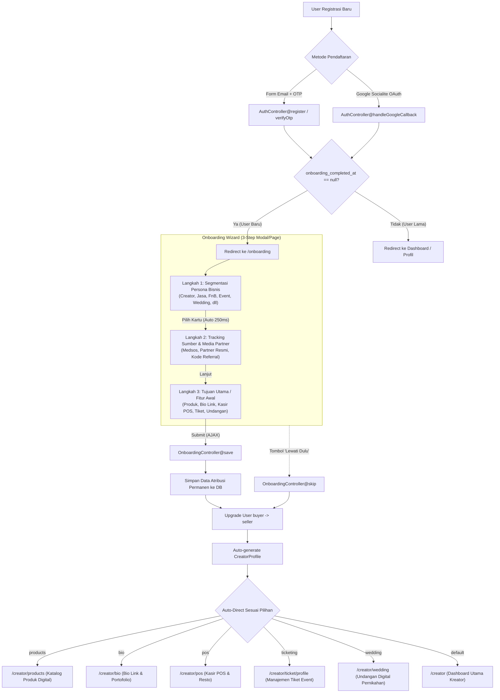

# Dokumentasi Sistem Onboarding Wizard Super App – buyle.id

Dokumen ini berisi spesifikasi teknis, arsitektur data, alur bisnis, serta panduan pengembangan sistem **Onboarding Wizard** di platform **buyle.id**. Ditulis secara komprehensif agar dapat dijadikan referensi utama bagi tim pengembang, desainer, analis bisnis, maupun *AI agent* di masa mendatang.

---

## 1. Ringkasan Eksekutif & Latar Belakang

Sistem Onboarding Wizard buyle.id dibuat untuk memecahkan beberapa kebutuhan penting:
1. **Segmentasi Persona Bisnis (*Progressive Profiling*):** Mengetahui latar belakang dan jenis industri user baru (Kreator Digital, Jasa, FnB/Resto, Event Creator, Undangan Digital, Media Partner, Korporasi, Ritel).
2. **Atribusi Sumber & Tracking Partner/Afiliasi Permanen:** Merekam dari mana user mengetahui buyle.id (Medsos, Media Partner resmi, atau Kode Referral/Afiliasi). Data ini disimpan permanen di profil user untuk keperluan komisi afiliasi, bagi hasil media partner, dan analitik pemasaran.
3. **Penyambutan Terarah (*Auto-Direct*):** Mengarahkan user baru langsung ke fitur yang mereka butuhkan secara instan (Produk Digital, Kasir POS, Bio Link, Tiket Acara, atau Undangan Pernikahan).
4. **Peningkatan Role Otomatis (*Seamless Creator Onboarding*):** Meng-upgrade role `buyer` menjadi `seller` secara otomatis dan membuat instans `CreatorProfile` saat menyelesaikan atau melewati onboarding, sehingga user dapat langsung berkarya tanpa terhalang birokrasi formulir manual.
5. **Standar UI/UX Super App:** Tampilan dirancang *mobile-first*, adaptif, anti-nabrak, menggunakan token warna resmi buyle.id (`#1eb349`), font Montserrat, dan animasi stepper yang mulus.

---

## 2. Diagram Alur Sistem (*User Journey Architecture*)



---

## 3. Skema Basis Data (*Database Schema*)

### Migrasi: `database/migrations/2026_11_17_005302_add_onboarding_and_attribution_to_users_table.php`

Kolom-kolom yang ditambahkan ke tabel `users`:

| Nama Kolom | Tipe Data | Nullable | Nilai Default | Deskripsi & Contoh Nilai |
|---|---|---|---|---|
| `business_persona` | `VARCHAR(50)` | Ya | `NULL` | Kategori persona bisnis user. Contoh: `creator_digital`, `jasa_digital`, `fnb_resto`, `event_creator`, `wedding_organizer`, `content_creator`, `media_partner`, `b2b_corporate`. |
| `referral_source_type` | `VARCHAR(50)` | Ya | `NULL` | Jenis kanal sumber referensi: `social_media`, `media_partner`, atau `other`. |
| `referral_source_name` | `VARCHAR(100)` | Ya | `NULL` | Nama spesifik sumber: `instagram`, `tiktok`, `youtube`, `google`, `twitter`, `friend`. |
| `media_partner_name` | `VARCHAR(100)` | Ya | `NULL` | Nama media partner jika dipilih di Step 2 (misal: "Event Jawa Timur", "Info Surabaya"). |
| `media_partner_id` | `BIGINT UNSIGNED` | Ya | `NULL` | Relasi ID ke media partner (tabel `hero_slides` atau partner entity). |
| `referral_code` | `VARCHAR(50)` | Ya | `NULL` | Kode referral/afiliasi unik (misal: `BUYLEVIP`, `KOMUNITASPRO`, atau username pemilik bio seperti `mse`). |
| `referrer_id` | `BIGINT UNSIGNED` | Ya | `NULL` | Foreign key ke `users.id` pemilik referral/bio link. Diindeks untuk relasi Eloquent cepat `$user->referrer`. |
| `primary_goal` | `VARCHAR(50)` | Ya | `NULL` | Fitur utama yang ditargetkan user: `products`, `bio`, `pos`, `ticketing`, `wedding`. |
| `onboarding_completed_at` | `TIMESTAMP` | Ya | `NULL` | Timestamp kapan user menyelesaikan onboarding. User lama otomatis diisi waktu migrasi agar tidak ter-redirect ulang. |

### Model Eloquent: `App\Models\User.php`
Semua kolom di atas telah ditambahkan ke array `$fillable` dan relasi pada model:
```php
protected $fillable = [
    // ... atribut bawaan ...
    'business_persona',
    'referral_source_type',
    'referral_source_name',
    'media_partner_name',
    'media_partner_id',
    'referral_code',
    'referrer_id',
    'primary_goal',
    'onboarding_completed_at',
];

public function referrer()
{
    return $this->belongsTo(User::class, 'referrer_id');
}

public function referrals()
{
    return $this->hasMany(User::class, 'referrer_id');
}
```

---

## 3.1 Sistem Tracker Anti-Lepas Bio Badge (Tema 1 s.d. 5)

Fitur ini memastikan bahwa setiap pengunjung yang datang ke halaman Biolink kreator (`/{username}`) lalu mengklik logo/badge buyle di bagian paling bawah halaman akan **terkunci selamanya (*Anti-Lepas*)** ke referral akun kreator tersebut saat mendaftar.

### Mekanisme 3 Lapis (*Triple-Lock Mechanism*):

1. **Lapis 1: Server-Side Cookie Queue (Masa Aktif 30 Hari)**
   - Saat pengunjung membuka `/{username}` (melalui `BioPageController@show`), sistem otomatis mengantrekan cookie:
     - `buyle_referral = username` (path: `/`, max-age: 30 hari).
     - `buyle_referrer_id = user_id` (path: `/`, max-age: 30 hari).
2. **Lapis 2: Deep Link & Web Middleware Sync (`CaptureUtmMiddleware`)**
   - Logo buyle di Tema 1, 2, 3, 4, dan 5 diarahkan ke URL berparameter:
     `https://buyle.id/?ref={username}&src=bio_footer&utm_source=bio_badge&utm_medium={username}`
   - `CaptureUtmMiddleware` berjalan di seluruh request web buyle.id:
     - Membaca `ref`, mencocokkan ke database pemilik akun, menyimpan ke session (`referral_code`, `referrer_id`, `referral_source_type = 'creator_bio'`).
     - Jika query string URL hilang karena user mengklik halaman lain, middleware otomatis membaca kembali cookie `buyle_referral` dan memasukkannya kembali ke session tanpa putus.
3. **Lapis 3: Client-Side Storage Lock (`localStorage`)**
   - Saat halaman bio dibuka atau logo diklik, JavaScript mengunci nilai ke `localStorage.setItem('buyle_referral', username)`.
   - Di form pendaftaran Email & Google OAuth (`register`, `register_email`, `onboarding`), jika parameter kosong, JavaScript lapis 3 secara otomatis menarik nilai dari `localStorage` dan mengisikannya ke payload pendaftaran.

### Hasil saat Registrasi:
- User baru yang terdaftar langsung memiliki:
  - `referrer_id` = ID pemilik bio page (misal ID akun `mse`).
  - `referral_code` = Username pemilik bio page (misal `mse`).
  - `referral_source_type` = `'creator_bio'`.
  - `referral_source_name` = `'Bio Badge (@mse)'`.
- Di Onboarding Wizard (`/onboarding`), kotak referral otomatis terisi dan terkoneksi dengan badge: *"Terkoneksi dengan referral @mse"*.

---

## 4. Rincian Endpoint & Controller

### 4.1 Rute Web (`routes/web.php`)
```php
Route::middleware(['auth'])->group(function () {
    Route::get('/onboarding', [\App\Http\Controllers\OnboardingController::class, 'index'])->name('onboarding.index');
    Route::post('/onboarding/save', [\App\Http\Controllers\OnboardingController::class, 'save'])->name('onboarding.save');
    Route::post('/onboarding/skip', [\App\Http\Controllers\OnboardingController::class, 'skip'])->name('onboarding.skip');
});
```

### 4.2 Controller: `App\Http\Controllers\OnboardingController.php`

#### A. Method `index(Request $request)`
- **Validasi Akses:** Jika role adalah `super_admin`, `admin`, atau `pos_cashier`, langsung di-bypass ke halaman utama/dashboard.
- **Cek Status:** Jika user sudah pernah menyelesaikan onboarding (`onboarding_completed_at !== null`), langsung diarahkan ke `/creator/dashboard`.
- **Query Media Partner:**
  - Diambil dari tabel `hero_slides` dengan filter `position = 'partner'` dan `is_active = true`.
  - Jika belum ada data partner di database, disediakan fallback berupa curated partner list buyle.id.
- **Deteksi Referral Otomatis:** Menangkap kode referral dari parameter URL `?ref=...`, `?aff=...`, atau `session('referral_code')`.
- **Render View:** Mengirim data ke `resources/views/auth/onboarding.blade.php`.

#### B. Method `save(Request $request)`
Menerima payload JSON dari AJAX:
```json
{
  "_token": "...",
  "business_persona": "creator_digital",
  "referral_source_type": "social_media",
  "referral_source_name": "instagram",
  "media_partner_name": null,
  "media_partner_id": null,
  "referral_code": "BUYLEVIP",
  "primary_goal": "products"
}
```
**Operasi yang dijalankan:**
1. Validasi request input.
2. Update tabel `users` dengan atribut pilihan & mencatat `onboarding_completed_at = now()`.
3. Auto-upgrade role dari `buyer` ke `seller`.
4. Auto-generate profil kreator via `CreatorProfile::getOrCreateForUser($user)`.
5. Mengembalikan JSON response:
```json
{
  "success": true,
  "redirect_url": "https://buyle.id/creator/products",
  "message": "Profil berhasil disimpan! Menyiapkan dashboard Anda..."
}
```

#### C. Method `skip(Request $request)`
- Dipanggil saat user menekan tautan *"Lewati dulu"*.
- Mengisi `onboarding_completed_at = now()`, meng-upgrade role ke `seller`, membuat profil kreator, dan me-redirect ke `/creator/dashboard` dengan notifikasi informatif.

### 4.3 Integrasi Auth (`App\Http\Controllers\AuthController.php`)
Diperbarui pada 3 titik otentikasi pendaftaran baru:
1. **Method `register()`** (Email form registrasi inline OTP):
   ```php
   $redirectRoute = ($user->onboarding_completed_at === null) ? route('onboarding.index') : route('account.profile');
   ```
2. **Method `verifyOtp()`** (Verifikasi kode OTP pendaftaran reguler):
   ```php
   $redirectRoute = ($user->onboarding_completed_at === null) ? route('onboarding.index') : route('account.profile');
   ```
3. **Method `handleGoogleCallback()`** (OAuth Google Socialite):
   ```php
   $destination = ($user->onboarding_completed_at === null && !in_array($user->role, ['super_admin', 'admin', 'pos_cashier'])) 
       ? route('onboarding.index') 
       : ($target ?: $fallback);
   ```

---

## 5. Rincian Antarmuka & UX (`resources/views/auth/onboarding.blade.php`)

### Desain & Struktur Layout
- **Responsif Adaptif (Mobile Portrait & Desktop Landscape):**
  - **Mobile (< 640px):** Mode portrait ala Super App (lebar 100%, persona 2 kolom, touch target minimal 44px, anti-nabrak).
  - **Tablet (640px s.d. 1023px):** Lebar kartu `760px`, persona 4 kolom, medsos 3 kolom, goals 2 kolom.
  - **Desktop (>= 1024px):** Lebar kartu `940px` horizontal landscape leluasa, persona 4 kolom (2 baris x 4 kolom simetris), medsos 6 kolom (1 baris horizontal), dan goals 2 kolom proporsional.
- **Header:** Menampilkan logo resmi dari navbar buyle.id (`\App\Models\Setting::get('logo')`), pill langkah aktif (`Langkah X dari 3`), dan animasi *linear progress track* (33% $\rightarrow$ 66% $\rightarrow$ 100%).
- **Micro-Interactions:**
  - Pada **Langkah 1**, saat kartu persona ditekan, sistem memberikan jeda halus `250ms` sebelum otomatis maju ke **Langkah 2** (*auto-advance* ala Super App).
  - Pilihan yang aktif memiliki border tebal `#1eb349`, latar belakang hijau lembut `#f4fbf6`, bayangan elevasi, dan checkmark badge mengambang.
- **Sticky Footer Bar:**
  - Tombol **Kembali** (*hidden* di Langkah 1, aktif di Langkah 2 & 3).
  - Tombol **Lanjut / Mulai Sekarang** (otomatis *enabled* jika validasi langkah terpenuhi; menampilkan spinner loading saat AJAX berjalan).
  - *Catatan:* Opsi "Lewati dulu" dinonaktifkan sehingga pengguna diarahkan untuk menyelesaikan orientasi profil secara terpadu.

### Peta Tujuan (*Auto-Direct Mapping*)

| Value `primary_goal` | Nama Opsi di UI | Target Redirect URL |
|---|---|---|
| `products` | Jual Produk & Jasa Digital | `/creator/products` |
| `bio` | Buat Bio Link & Portofolio | `/creator/bio` |
| `pos` | Sistem Kasir POS & Resto | `/creator/pos` |
| `ticketing` | Jual Tiket Acara & QR Check-in | `/creator/ticket/profile` |
| `wedding` | Undangan Digital & Wedding | `/creator/wedding` |
| *(default)* | Dashboard Kreator Umum | `/creator` |

---

## 6. Panduan untuk Tim & AI Agent Selanjutnya (*Maintenance & Extension Guide*)

### 1. Menambahkan Persona Bisnis Baru
1. Buka file [onboarding.blade.php](file:///c:/Users/dgtil/Downloads/PENTING/HVM%20Digital/CLIENT%20Local%20WEB%20%26%20Deploy/buyle.id%20ex%20alaatrumah/resources/views/auth/onboarding.blade.php).
2. Di dalam kontainer `.persona-grid`, tambahkan elemen kartu baru:
   ```html
   <div class="persona-card" onclick="selectPersona('nama_persona_baru', this)">
       <div class="check-badge">...</div>
       <div class="card-icon-wrap">...SVG ICON...</div>
       <div class="card-info">
           <div class="card-title">Judul Persona</div>
           <div class="card-desc">Deskripsi singkat</div>
       </div>
   </div>
   ```
3. Sesuaikan validasi di [OnboardingController.php](file:///c:/Users/dgtil/Downloads/PENTING/HVM%20Digital/CLIENT%20Local%20WEB%20%26%20Deploy/buyle.id%20ex%20alaatrumah/app/Http/Controllers/OnboardingController.php) bila menambahkan aturan `in:...`.

### 2. Mendaftarkan Media Partner Resmi ke Onboarding
Media partner dibaca langsung secara dinamis dari database. Anda dapat menambahkan media partner melalui Admin Panel atau query:
```sql
INSERT INTO hero_slides (title, position, image, button_url, is_active, `order`, created_at, updated_at)
VALUES ('Nama Media Partner', 'partner', 'hero_slides/partner_logo.png', 'https://instagram.com/partner', 1, 1, NOW(), NOW());
```
Sistem secara otomatis akan me-render partner tersebut di Tab *"Media Partner Resmi"* pada Langkah 2.

### 3. Mengubah atau Menambah Rute Auto-Direct
Buka [OnboardingController.php](file:///c:/Users/dgtil/Downloads/PENTING/HVM%20Digital/CLIENT%20Local%20WEB%20%26%20Deploy/buyle.id%20ex%20alaatrumah/app/Http/Controllers/OnboardingController.php) pada method `save()`:
```php
$redirectUrl = match ($validated['primary_goal']) {
    'products'  => url('/creator/products'),
    'bio'       => url('/creator/bio'),
    'pos'       => url('/creator/pos'),
    'ticketing' => url('/creator/ticket/profile'),
    'wedding'   => url('/creator/wedding'),
    'custom'    => url('/url/tujuan/baru'), // <--- Tambah di sini
    default     => url('/creator'),
};
```

### 4. Query Tracking untuk Tim Marketing & Afiliasi
Untuk melihat performa atribusi dan persebaran persona pengguna baru:
```sql
-- Rekap persona bisnis
SELECT business_persona, COUNT(*) as total_users
FROM users
WHERE onboarding_completed_at IS NOT NULL
GROUP BY business_persona
ORDER BY total_users DESC;

-- Rekap user berdasarkan Media Partner
SELECT media_partner_name, COUNT(*) as total_referrals
FROM users
WHERE referral_source_type = 'media_partner'
GROUP BY media_partner_name
ORDER BY total_referrals DESC;

-- Rekap konversi kode referral affiliator
SELECT referral_code, COUNT(*) as total_conversions
FROM users
WHERE referral_code IS NOT NULL AND referral_code != ''
GROUP BY referral_code
ORDER BY total_conversions DESC;
```

---

## 7. Integrasi Admin All User, Auto-NIK E-Tiket & Ekspor Laporan

### 7.1. Transformasi Menu Sidebar Admin "All User"
- Menu sidebar diubah dari `Pengguna (Buyer)` menjadi **`All User`** (`resources/views/layouts/admin.blade.php`).
- Halaman index (`/admin/users`) memuat seluruh data akun pengguna (baik pembeli maupun kreator) yang dilengkapi filter berdasarkan **Persona Bisnis** dan **Sumber Tahu**, pencarian terpadu (nama, email, no HP, NIK, username), serta indikator badge persona, NIK, dan jumlah e-tiket.

### 7.2. Tampilan Data Onboarding di Detail Pengguna (`/admin/users/{id}`)
Halaman detail pengguna dilengkapi kartu terpisah bergaya *luxury clean* khusus untuk data onboarding:
1. **Tipe Bisnis / Persona:** Kategori yang dipilih user beserta penjelasannya.
2. **Sumber Tahu Buyle & Media Partner:** Jenis saluran (Medsos, Media Partner, Teman, Iklan, Google) dan detail nama platform/mitra penyelenggara.
3. **Tujuan Utama Penggunaan (Primary Goal):** Fokus fitur awal (Produk Digital, Landing Page, Kasir POS, E-Tiket Event, Undangan Digital).
4. **Afiliasi & Referral Tracker:** Kode referral unik dan profil akun pengundang (*referrer*).
5. **Status & Waktu Selesai:** Timestamp penyelesaian proses onboarding wizard.

### 7.3. Logika Auto-NIK dan Integrasi E-Tiket
1. **Kolom NIK pada Tabel `users`:** Ditambahkan kolom `nik VARCHAR(50) NULL` pada tabel `users` (`database/migrations/2026_11_17_142417_add_nik_to_users_table.php`).
2. **Auto-Populate saat Pembelian Tiket:**
   - Ketika pengguna membeli tiket event di halaman `/checkout` dan mengisi nomor identitas resmi (KTP/NIK), sistem melalui `CheckoutService` dan `TicketPass::generateForOrder` secara otomatis menyinkronkan NIK tersebut ke profil pengguna (`users.nik`).
3. **Auto-Fill saat Checkout Berikutnya:**
   - Jika pengguna yang sedang login kembali melakukan transaksi tiket, kolom input NIK pada slot tiket pertama akan **otomatis terisi** dengan NIK yang telah tersimpan di akunnya atau riwayat tiket sebelumnya, sehingga pembeli tidak perlu repot mengetik ulang.
4. **Relasi Eloquent:**
   - Ditambahkan relasi `User::ticketPasses()` ke model `TicketPass`.
   - Ditambahkan accessor `User::getResolvedNikAttribute()` yang mengembalikan NIK tersimpan atau fallback ke NIK tiket terakhir milik pengguna.

### 7.4. Sistem Ekspor Laporan Data Pengguna
1. **Ekspor Seluruh Pengguna (All Users Export):**
   - URL: `/admin/users/export?format=xlsx` atau `format=csv`.
   - Class: `App\Exports\AllUsersExport`.
   - Menyertakan data lengkap profil, NIK, seluruh detail onboarding, media partner, referral, status akun, jumlah transaksi, total spending, dan total tiket.
2. **Ekspor Aktivitas Spesifik Per Pengguna:**
   - URL: `/admin/users/{id}/export?format=xlsx` atau `format=csv`.
   - Class: `App\Exports\UserActivityExport`.
   - Berisi 5 blok data terstruktur: Informasi Akun, Data Onboarding, Riwayat Order Lengkap, Riwayat E-Tiket, dan Daftar Alamat Pengiriman.
3. **Pratinjau Cetak & Simpan PDF:**
   - URL: `/admin/users/{id}/print`.
   - View: `resources/views/admin/users/print.blade.php`.
   - Desain dokumen resmi siap cetak / PDF dengan tombol *1-click print* dan CSS `@media print` rapi.

---

## 8. Riwayat File Terkait

- **Migrasi Onboarding:** `database/migrations/2026_11_17_005302_add_onboarding_and_attribution_to_users_table.php`
- **Migrasi Referrer ID:** `database/migrations/2026_11_17_100455_add_referrer_id_to_users_table.php`
- **Migrasi NIK User:** `database/migrations/2026_11_17_142417_add_nik_to_users_table.php`
- **Model:** `app/Models/User.php`, `app/Models/TicketPass.php`
- **Exports:** `app/Exports/AllUsersExport.php`, `app/Exports/UserActivityExport.php`
- **Controller Admin User:** `app/Http/Controllers/Admin/AdminUserController.php`
- **Service Checkout:** `app/Services/CheckoutService.php`
- **View Admin User:**
  - `resources/views/admin/users/index.blade.php` (All User list & filter)
  - `resources/views/admin/users/show.blade.php` (Detail profil, onboarding card, tiket, orders)
  - `resources/views/admin/users/print.blade.php` (Printable report / PDF)
- **View Layout Admin:** `resources/views/layouts/admin.blade.php` (Sidebar All User)
- **View Checkout:** `resources/views/ecommerce/checkout.blade.php` (Auto-fill NIK)
- **View Onboarding Wizard:** `resources/views/auth/onboarding.blade.php`
- **Dokumentasi Utama:** `onboarding-buyle.md`
